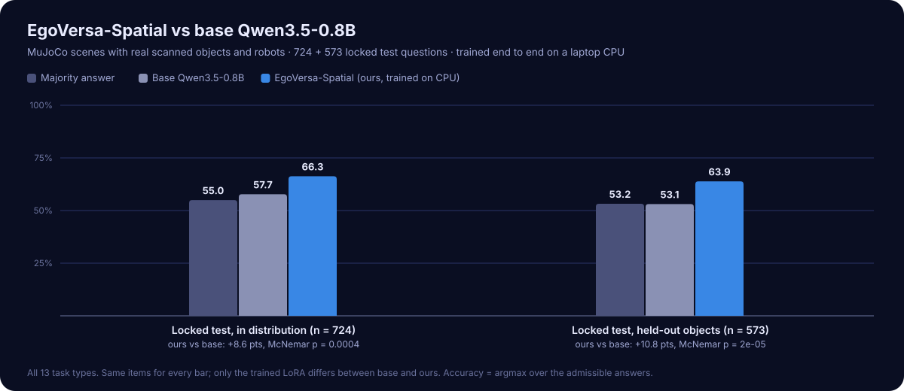
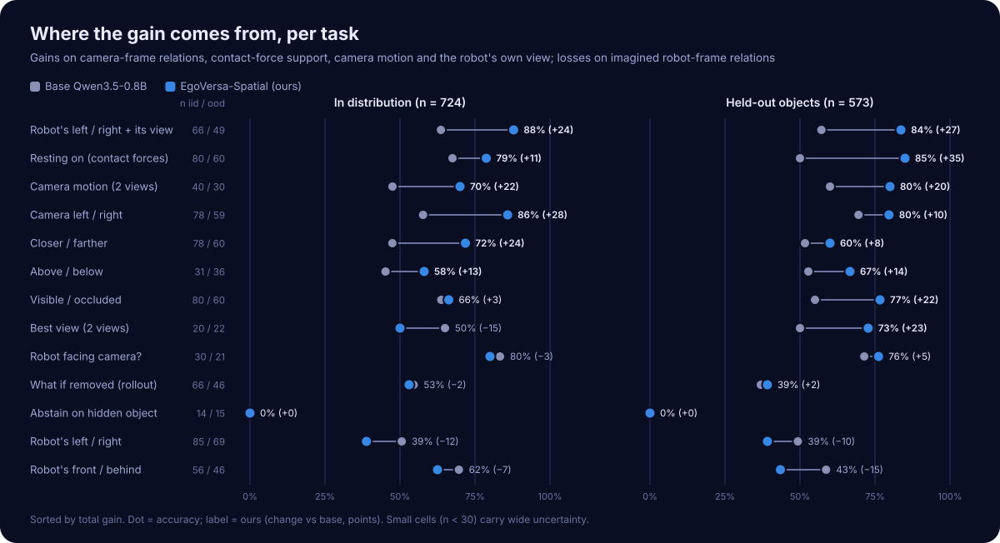
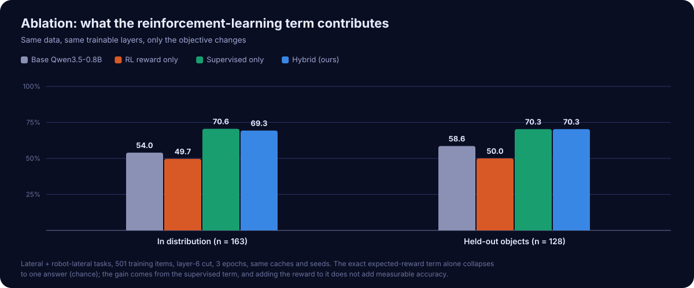
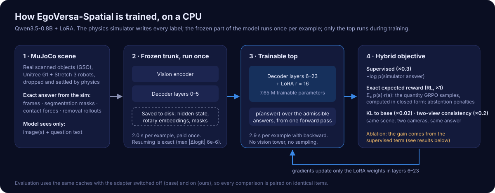
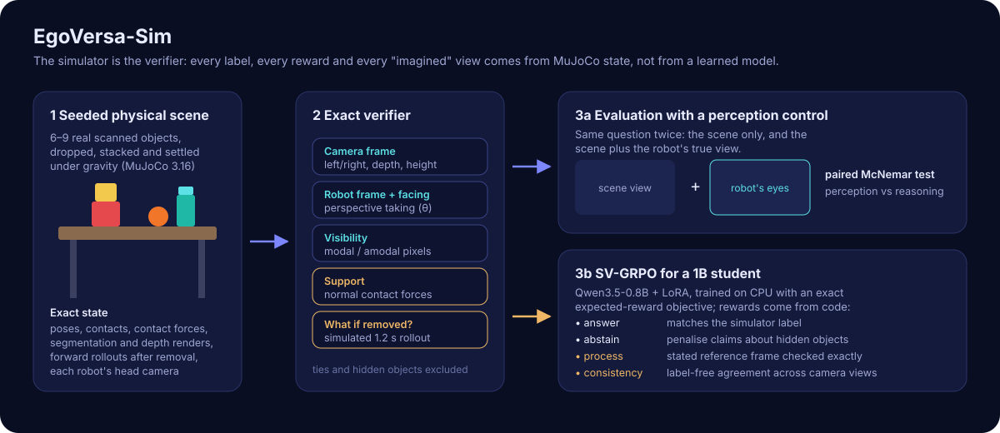
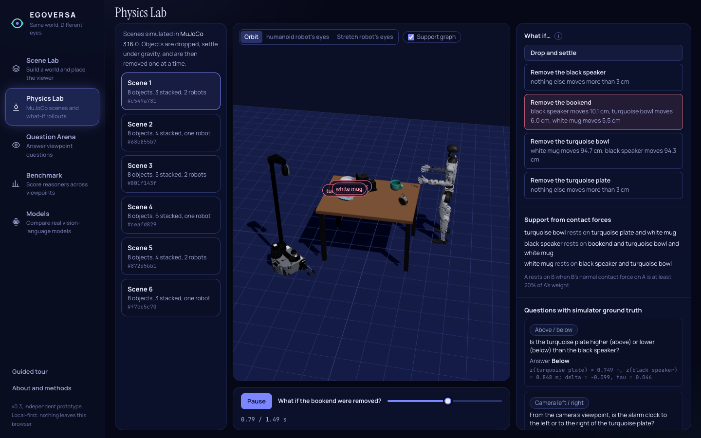
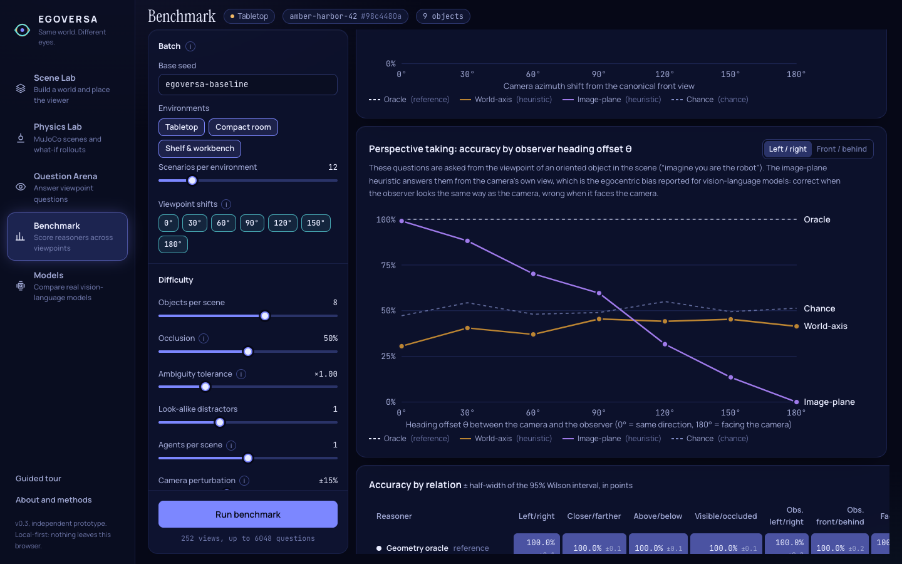
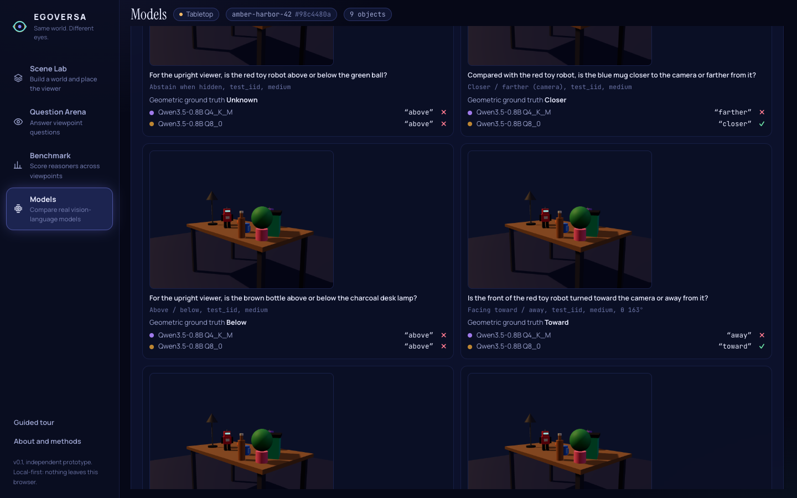

<div align="center">

# EGOVERSA

### Same world. Different eyes.

**A physics-grounded spatial-reasoning lab, and a 0.8B vision-language model trained for it on a laptop CPU.**

By **Harishik Dev Singh Jamwal**

[](LICENSE)


[-8A2BE2.svg)](https://huggingface.co/Qwen/Qwen3.5-0.8B)


[Results](#results) · [How it works](#how-our-system-works) · [Simulator](#egoversa-sim-mujoco) · [Workbench](#the-workbench) · [Quick start](#quick-start) · [Experiments](EXPERIMENTS.md)

</div>


Vision-language models are bad at "left of whom?". Ask a small model whether the mug is on *the robot's*
left and it answers from the camera, or always says "left". EGOVERSA builds scenes where every answer is
known exactly, because a **physics simulator** computes it. It then trains a compact model on them with
nothing but a CPU, and measures what changed on test sets the training never touched.

## Results



| | Model | Locked test, in distribution (n = 724) | Locked test, held-out objects (n = 573) |
|---|---|---|---|
| baseline | Majority answer per task | 55.0% | 53.2% |
| baseline | Base Qwen3.5-0.8B | 57.7% | 53.1% |
| **ours** | **EgoVersa-Spatial (Qwen3.5-0.8B + LoRA, CPU-trained)** | **66.3%** | **63.9%** |
| | Paired difference, exact McNemar | +8.6 pts, p = 0.0004 | +10.8 pts, p = 0.00002 |

The held-out test split uses four objects that never appear in training (teapot, rhino, lunch box, teal
basket). Answering freely, without the answer list, moves the same way: 48.5% → 63.3% and 44.5% → 60.4%.



**What improved:** camera-frame left/right (+28 / +10), closer/farther, what rests on what (from contact
forces, +11 / +35), camera motion between two views, and the robot's left/right when its own view is
attached (+24 / +27).

**What did not:** the robot's left/right and front/behind *without* its view got worse. The model learned
to read a viewpoint, not to imagine one. Removal what-ifs did not move. It still never answers "unknown".
These are open problems, not footnotes.

### What the reinforcement-learning term contributes



We trained the same layers on the same data three ways. **The exact expected-reward (RL) term on its own
collapses to a single answer**: it says "left" to all 163 test items. Supervised training alone reaches
the same accuracy as our hybrid. On this data the gain comes from the supervised term, and the RL term
adds no measurable accuracy on top. We report this as found. Making the reward term useful (process
rewards on the stated reference frame, harder negatives) is the next experiment, not a claim.

Every number above comes from `research/runs/*/report.json`. They are summarised in
[`research/results/cpu_training_summary.json`](research/results/cpu_training_summary.json) and drawn by
[`research/scripts/make_figures.py`](research/scripts/make_figures.py). Full write-up, including the two
runs that failed and why: [EXPERIMENTS.md §E6](EXPERIMENTS.md).

## How our system works



| Part | What it is |
|---|---|
| **Data** | MuJoCo scenes of real scanned objects and real robots. The simulator gives the exact answer to 13 question types: camera and robot frames, visibility from segmentation masks, support from contact forces, what-if removal by forward simulation, two-view camera motion. The model sees only the image(s) and question text. |
| **Model** | `Qwen/Qwen3.5-0.8B` with LoRA (r = 16) on decoder layers 6–23, 7.65 M trainable parameters. |
| **CPU training** | The vision tower and layers 0–5 are frozen. Their output is computed once per example and saved, and resuming from it reproduces the full model's logits to 6e-6. Training then runs only layers 6–23: 2.9 s per example with backward on an 8-thread Intel Mac, with no vision tower and no sampling. |
| **Objective** | Supervised term on the simulator's answer, plus the **exact** expected reward Σₐ p(a)·r(a) over the admissible answers. This is the quantity GRPO estimates by sampling, computed in one pass with zero variance. Also a KL penalty to the base model and label-free two-view consistency. Batches hold one task type with balanced answers, so the model cannot win by learning a label prior. |
| **Evaluation** | Locked test splits (hashed before any training). Base and ours are scored on identical items from the same caches, and every difference gets an exact McNemar test. |

What made it work, in order: (1) moving the trainable cut from layer 16 down to layer 6 (with only the top
8 layers trainable, the model cannot learn these relations at all, see the capacity ablation), (2)
label-balanced batches, (3) fixing a dataset bias where every front/behind answer was "front".

## Quick start

**Browser workbench.** No model, GPU or key needed.

```bash
npm install
```

```bash
npm run dev
```

Open http://localhost:5173.

**Real model inference.** Ollama must be installed; the app shows "not installed" otherwise and never
fakes an answer.

```bash
ollama pull qwen3.5:0.8b
```

```bash
npm run model-server
```

**Research pipeline.** See [docs/REPRODUCIBILITY.md](docs/REPRODUCIBILITY.md) for every command.

```bash
npm run dataset -- --config research/configs/dataset.smoke.json
```

```bash
python3 research/scripts/validate_dataset.py research/data/egoversa-smoke
```

```bash
npm run eval:models -- --dataset research/data/egoversa-smoke --model qwen3.5-0.8b-base
```

```bash
conda env create -p research/.conda -f research/environment.yml
```

```bash
research/.conda/bin/python research/scripts/train_student.py --config research/configs/experiments/smoke.yaml --smoke
```

### All commands

| Command | What it does |
|---|---|
| `npm run dev` / `build` / `preview` | Web app (Vite) |
| `npm test` | 89 Vitest tests: geometry, observer frames, dataset items, parsing, scoring |
| `npm run e2e` | Build, then a Playwright run of every main flow in Google Chrome, including a real model reply |
| `npm run benchmark` | Geometry benchmark of the built-in heuristics → `reports/` |
| `npm run dataset -- --config <json>` | Render + label a dataset, lock its test splits |
| `npm run model-server` | Local inference API (Ollama backend) with an allow-listed request schema |
| `npm run eval:models -- --dataset <dir> --model <id>` | Evaluate a real model → `research/results/` |
| `npm run screenshots` | Re-capture `docs/screenshots/` |
| `research/scripts/train_cpu.py` | CPU training: trunk cache + hybrid objective + paired evaluation (`--cut`, `--alpha-rl`, `--gamma-ce`, `--eval-only`) |
| `research/scripts/make_figures.py` | Rebuild the result figures from the run reports |
| `research/scripts/validate_dataset.py` | Schema, leakage, split, lock and licence-track checks |
| `research/scripts/train_student.py` | Multimodal LoRA training (`--dry-run`, `--smoke`, `--resume`) |
| `research/scripts/evaluate_models.py` | Evaluate a HF checkpoint or LoRA adapter (Transformers backend) |
| `research/scripts/run_teacher.py` | Collect and verify SpatialAxiom-9B outputs (research track only) |
| `research/scripts/mine_hard_examples.py` | Hard examples from train / val mistakes only |
| `research/scripts/quantize_model.py` | Merge → GGUF + vision projector → Q8_0 / Q4_K_M → Ollama |
| `research/scripts/serve_model.py` | Serve a HF checkpoint or adapter over the same API |
| `pytest research/tests` | 52 Python tests (dataset integrity, holdout guard, licence tracks, CLIs, MuJoCo verifier, rewards, exact-expectation objective, balanced batches) |

## EgoVersa-Sim (MuJoCo)




| | |
|---|---|
| Simulator | MuJoCo 3.16 (conda-forge build for Intel macOS; `research/environment.yml`) |
| Scenes | v0.5.0. A wood table with 6–9 **real scanned household objects** (27 from Google Scanned Objects: mugs, bowls, plates, speakers, an alarm clock, shoes, planters, toy animals, a cereal box…) at their real masses, dropped, some stacked, settled under gravity; 1–2 **real robot models** from MuJoCo Menagerie (Unitree G1 humanoid, Hello Robot Stretch 3) whose eye camera sits at the head sensor. Four assets are held out of training and appear only in the OOD test split. 40% of robots stand with their back to the table, so front/behind and toward/away are balanced |
| Exact labels | Camera-frame relations, robot-frame relations, facing, segmentation-based visibility, **support from contact forces**, **counterfactual removal by forward simulation**, abstention on hidden objects, two-view tasks |
| Imagery condition | Each observer left/right question is also asked with the robot's own rendered view attached, paired one-to-one for an exact McNemar test |
| Training | **CPU**: `train_cpu.py` (trunk cache + hybrid objective, the results above). GPU paths kept: SFT (`train_student.py`) and sampled SV-GRPO (`train_grpo.py`) |
| In the app | **Physics Lab**: replays recorded MuJoCo trajectories with the textured scanned meshes and the robot CAD meshes (settling and what-if removals), draws the support graph, and switches to any robot's exact eye camera |
| Assets | `research/scripts/fetch_assets.py` downloads them (gitignored); licences in `research/assets/ATTRIBUTION.md` and `public/sim/assets/LICENSES.md` |

```bash
research/.conda/bin/python research/scripts/fetch_assets.py
```

```bash
MUJOCO_GL=cgl research/.conda/bin/python research/scripts/build_sim_dataset.py --config research/configs/sim.smoke.json
```

```bash
research/.conda/bin/python research/scripts/export_sim_scenes.py --count 6
```

```bash
research/.conda/bin/python research/scripts/train_cpu.py --dataset research/data/egoversa-sim-pilot-v05 --out research/runs/cpu_epo_v05_k6 --cut 6 --train-limit 2000 --epochs 2 --lr 1e-4 --max-side 384
```

Positioning against 2025–26 work (APC, ViewSpatial, MindCube, SpinBench, FlipSet, SVQA-R1, LeRF, DR-MV3D,
Astra, WorldMind and others) is in [docs/RELATED_WORK.md](docs/RELATED_WORK.md). Exact definitions are in
[docs/CONVENTIONS.md §8](docs/CONVENTIONS.md).

## The workbench

| Physics Lab: what-if removal rollout | Question Arena: a real model answers |
|---|---|
|  |  |
| **Benchmark: the egocentric-bias curve** | **Models: measured runs and sample explorer** |
|  |  |

- **Scene Lab.** Three procedural environments: tabletop, compact room, shelf and workbench.
  - Seed, object count, occlusion, look-alike distractors, pose noise, lighting, and 0–2 robots with a
    visible facing direction.
  - The viewport shows world axes (amber), the viewer camera as an object with its own axes (cyan),
    facing arrows on oriented objects, and the viewer's own image as an inset.
  - Every object is listed in world and camera coordinates with its ray-cast visibility.
  - Scenarios save locally and import/export as JSON.
- **Physics Lab.** Six recorded MuJoCo scenes. Watch objects drop and settle, then replay "what if the X
  were removed?" rollouts, with objects that move more than 3 cm highlighted. Shows the contact-force
  support graph, a view through any robot's head camera, and oracle-labelled questions. The browser only
  replays recordings; it never simulates or labels.
- **Question Arena.** Ten question types are drawn from the current view, from camera left/right to
  "imagine you are the robot".
  - You answer from the clean image; the app reveals the geometric ground truth with its evidence and
    what the heuristics predicted.
  - **Answer with a model** runs a real installed model on the same image and question, and shows the
    exact text it received, its raw reply, latency and revision.
  - An uninstalled model shows why, and no answer.
- **Benchmark.** Seeded batches across environments and camera shifts.
  - Accuracy with Wilson intervals, confusion matrices, a failure gallery with playback.
  - **Accuracy by observer heading offset θ**, the perspective-taking axis of the APC paper.
- **Models.**
  - A live registry: installed or not, licence, parameters, size, revision.
  - Up to four evaluation runs compared per task, against the **majority-answer** rate, with a flag on
    cells where a model gives one answer to nearly everything.
  - Left/right inversion, abstention recall, hidden-object hallucination, over-abstention, latency.
  - θ curves and a sample explorer with the real rendered images and every model's raw reply.

## The research question

Can a ~0.8B Qwen3.5 student, trained on geometry-verified data and optionally on verified
SpatialAxiom-9B signals, approach or beat the 9B specialist on unseen EgoVersa tasks at much lower
cost?

This is a hypothesis to test, not a claim. Hypotheses, runs (baseline, geometry, teacher, hybrid,
data-matched control, quantised, alternative student), metrics and success criteria are in
[docs/RESEARCH_PLAN.md](docs/RESEARCH_PLAN.md).

## Scientific guard rails

| Rule | How it is enforced |
|---|---|
| Models see only images and question text | Allow-listed request schema in the browser, the server and the dataset (`model_inputs/*.jsonl` has exactly three keys); prompts contain no digits or oracle vocabulary; tested |
| The test set stays blind | Test splits are built first and locked by digest; training, teacher collection and hard-example mining refuse locked ids and images; tested |
| No ambiguous labels | Ties, side-on facing and partly hidden objects are excluded; fully hidden objects become explicit "unknown" items |
| No fabricated results | The UI only displays live replies or result files; figures are generated from run reports; failed runs and negative ablations are reported |
| The oracle is not a model | Labelled a reference everywhere and never ranked against models |
| Teacher outputs are not truth | Every teacher reply is verified against the oracle and labelled verified / wrong / non-answer / hallucinated |
| Licence tracks stay apart | Permissive runs refuse teacher-derived examples ([docs/LICENSE_AND_PROVENANCE.md](docs/LICENSE_AND_PROVENANCE.md)) |

## Verification (run in this repository)

| Check | Result |
|---|---|
| `npm run typecheck` | exit 0 |
| `npm test` | 89 passed |
| `pytest research/tests` | 52 passed (incl. MuJoCo rendering tests, run with graphics access) |
| `npm run build` | passed |
| `npm run e2e` (production build, headless Chrome, live model server + Ollama) | passed; a real Qwen3.5-0.8B reply is received in the arena |
| `validate_dataset.py` on smoke and pilot | OK, 0 errors |
| CPU training, full run | 1,941 items × 2 epochs; trunk cache 3,358 items in 1.9 h, training 2.9 s/item; locked-test results above |

## Documentation

| | |
|---|---|
| [EXPERIMENTS.md](EXPERIMENTS.md) | All measured results (E1–E6), including failed runs, and what has not been run |
| [docs/RESEARCH_AND_SOURCES.md](docs/RESEARCH_AND_SOURCES.md) | Verified model cards, what SpatialAxiom and SpatialMosaic do and do not release, hardware |
| [docs/RESEARCH_PLAN.md](docs/RESEARCH_PLAN.md) | Hypotheses, runs, controls, metrics, success criteria |
| [docs/CONVENTIONS.md](docs/CONVENTIONS.md) | Exact definitions of every relation, frame and tolerance |
| [docs/DATASET_CARD.md](docs/DATASET_CARD.md) | Tasks, splits, locked holdout, layout, limitations |
| [docs/MODEL_CARD_DRAFT.md](docs/MODEL_CARD_DRAFT.md) | EgoVersa-Spatial-1B draft (no trained weights yet) |
| [docs/LICENSE_AND_PROVENANCE.md](docs/LICENSE_AND_PROVENANCE.md) | Permissive vs research-only tracks |
| [docs/REPRODUCIBILITY.md](docs/REPRODUCIBILITY.md) | Environments, seeds, every command |
| [docs/IMPLEMENTATION_PLAN.md](docs/IMPLEMENTATION_PLAN.md) | Milestones and status |

## Repository layout

```
src/geometry  src/scenes  src/tasks     camera model, ray casting, scenes, oracle, dataset items
src/evaluation                          heuristics, geometry benchmark, model adapters, parsing, model scoring
src/components                          three/ (incl. headless render target), workspaces/, charts/, panels/
server/model-server.mjs                 local inference API (Ollama backend)
scripts/                                dataset builder, model evaluation, geometry benchmark, screenshots
research/egoversa_research              Python: dataset integrity, parsing, SFT encoding, HF runtime, CPU trainer (cpu_train.py)
research/egoversa_sim                   MuJoCo scenes, verifier (visibility, support, counterfactuals), questions
public/sim                              recorded MuJoCo scenes replayed by the Physics Lab
research/scripts  research/configs      CLIs and YAML / JSON configs (datasets, models, experiments)
research/results                        real evaluation result files
reports/  docs/  tests/  e2e/
```

## Limitations

- Rendered scenes. The objects and robots are real scans and CAD models, but nothing here measures ability on real photos.
- One training seed per configuration so far; repeats are pending. Per-task cells under 30 items carry wide intervals.
- The RL reward term adds no measurable accuracy over supervised training on this data (ablation above).
- Imagined robot-frame relations (no robot view attached) and abstention are not solved.
- Teacher (SpatialAxiom-9B) runs need a ~24 GB GPU and were not executed.
- Exporting a trained student to GGUF needs a llama.cpp build that supports `qwen35`. Not executed.
- Image bytes can differ across GPUs or drivers. Hashes are recorded and the lock detects mismatches.

## Deployment

The web app builds to static files (`base: './'`) for GitHub Pages; `.github/workflows/deploy.yml`
tests, builds and deploys on push to `main` after Settings → Pages → Source: GitHub Actions. The model
server and research pipeline are local tools and are not deployed. The repository is on GitHub; Pages deployment has not been enabled.

## References

- P. Y. Lee et al. *Perspective-Aware Reasoning in VLMs via Mental Imagery Simulation.* ICCV 2025. https://arxiv.org/abs/2504.17207
- P. Y. Lee, C. Park et al. *Token Warping Helps MLLMs Look from Nearby Viewpoints.* CVPR 2026. https://arxiv.org/abs/2604.02870
- K. Lee et al. *SpatialMosaic: A Multiview VLM Dataset for Partial Visibility.* arXiv 2512.23365. https://kanghee-lee.github.io/spatialmosaic/
- Y. Lou et al. *SpatialAxiom.* 2026. https://d2i-ai.github.io/SpatialAxiom · https://huggingface.co/SpatialAxiom/SpatialAxiom-9B (CC BY-NC 4.0)
- E. Todorov, T. Erez, Y. Tassa. *MuJoCo: A physics engine for model-based control.* IROS 2012. https://mujoco.org
- Recent perspective-taking and spatial-RL work surveyed for v0.3: see [docs/RELATED_WORK.md](docs/RELATED_WORK.md).
- Qwen Team. *Qwen3.5-0.8B.* https://huggingface.co/Qwen/Qwen3.5-0.8B (Apache 2.0)
- OpenBMB. *MiniCPM-V 4.7 1B.* https://huggingface.co/openbmb/MiniCPM-V-4.7-1B (Apache 2.0)
- Unsloth. *Qwen3.5 fine-tuning guide.* https://unsloth.ai/docs/models/qwen3.5/fine-tune
- J. Johnson et al. *CLEVR.* CVPR 2017. https://arxiv.org/abs/1612.06890

## License

MIT © 2026 Harishik Dev Singh Jamwal, for the original code, documentation and generated data in this repository ([LICENSE](LICENSE)).
Models, dependencies and fonts keep their own licences.
