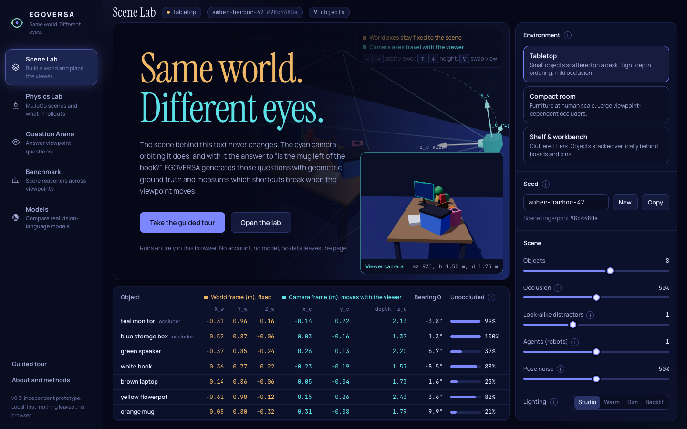
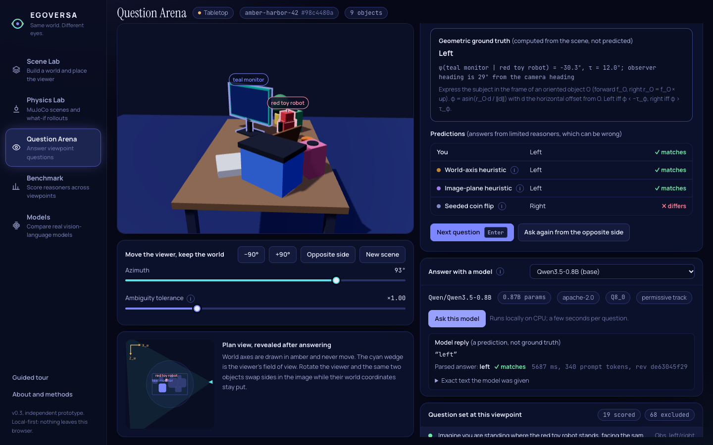
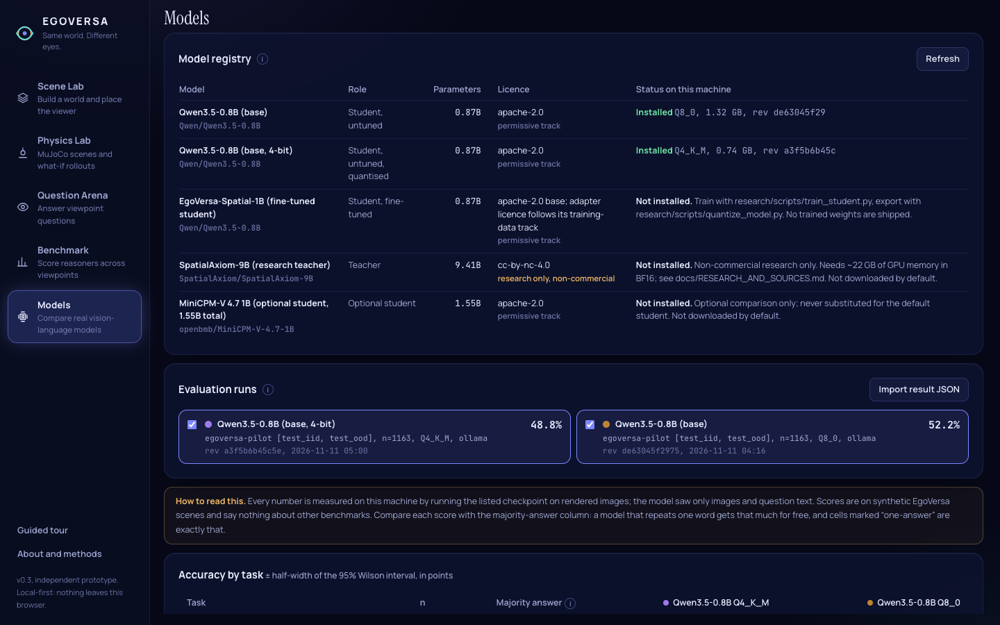
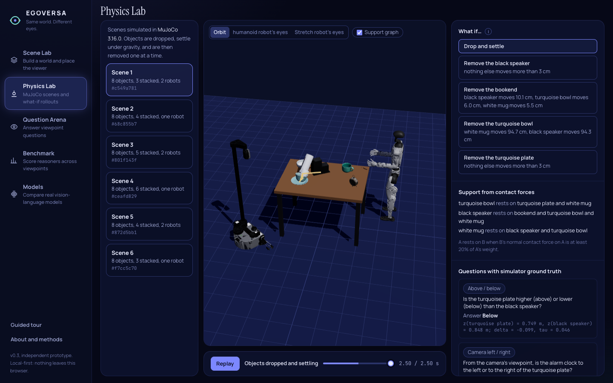

# EGOVERSA

**Same world. Different eyes.**

By Harishik Dev Singh Jamwal

[](LICENSE)


[](https://huggingface.co/Qwen/Qwen3.5-0.8B)
[](https://huggingface.co/SpatialAxiom/SpatialAxiom-9B)


A research workbench for viewpoint and perspective reasoning in vision-language models.

**v0.3 adds EgoVersa-Sim:** physics-grounded scenes in **MuJoCo**, where the simulator itself is the
verifier. Visibility comes from segmentation masks, "resting on" from contact forces, and "what if this were
removed?" from forward simulation. The robots' true first-person views drive a perfect-imagery experiment,
and a simulator-verified reinforcement-learning trainer (SV-GRPO) builds on these labels. See
[EgoVersa-Sim](#egoversa-sim-mujoco) below.

EgoVersa generates seeded 3D scenes and places a movable camera and oriented "observers" in them. It
derives camera-relative and observer-relative questions with exact geometric answers, renders them
into image datasets with a locked test set, and evaluates real models on them. It also contains the
pipeline to fine-tune a compact student, **EgoVersa-Spatial-1B** (built on `Qwen/Qwen3.5-0.8B`, a
1B-class model with 0.87 B parameters), on those answers.

> Independent portfolio prototype, written with the KAIST Visual AI Group's work on perspective-aware
> VLM reasoning in mind. Not an official lab project and not a reproduction of any paper.



| Question Arena: a real model answers | Benchmark: the egocentric-bias curve |
|---|---|
|  |  |
| **Models: registry and measured runs** | **Sample explorer** |
|  |  |

## Status at a glance

| | |
|---|---|
| **Done and measured** | Browser workbench; geometry oracle with 10 task types; 6,932-sample rendered pilot dataset with a locked 1,163-item test set; real evaluation of base Qwen3.5-0.8B at 8-bit and 4-bit; LoRA training verified end to end on CPU |
| **Implemented, not run** | Full fine-tuning runs (need a CUDA GPU); SpatialAxiom-9B teacher collection (needs ~24 GB GPU, non-commercial); GGUF export of a trained student |
| **Headline measurement** | Base Qwen3.5-0.8B: **52.2%** [49.3, 55.1] on the locked test set. It answers "front" to 135/135 front/behind questions and never says "unknown" to questions about hidden objects. Details: [EXPERIMENTS.md](EXPERIMENTS.md) |

No model has been fine-tuned yet. No accuracy for EgoVersa-Spatial-1B or for the teacher is claimed
anywhere in this repository.

## Quick start

**Browser workbench.** No model, GPU or key needed.

```bash
npm install
```

```bash
npm run dev
```

Open http://localhost:5173.

**Real model inference.** Ollama must be installed; the app shows "not installed" otherwise and never
fakes an answer.

```bash
ollama pull qwen3.5:0.8b
```

```bash
npm run model-server
```

**Research pipeline.** See [docs/REPRODUCIBILITY.md](docs/REPRODUCIBILITY.md) for every command.

```bash
npm run dataset -- --config research/configs/dataset.smoke.json
```

```bash
python3 research/scripts/validate_dataset.py research/data/egoversa-smoke
```

```bash
npm run eval:models -- --dataset research/data/egoversa-smoke --model qwen3.5-0.8b-base
```

```bash
conda env create -p research/.conda -f research/environment.yml
```

```bash
research/.conda/bin/python research/scripts/train_student.py --config research/configs/experiments/smoke.yaml --smoke
```

### All commands

| Command | What it does |
|---|---|
| `npm run dev` / `build` / `preview` | Web app (Vite) |
| `npm test` | 89 Vitest tests: geometry, observer frames, dataset items, parsing, scoring |
| `npm run e2e` | Build, then a Playwright run of every main flow in Google Chrome, including a real model reply |
| `npm run benchmark` | Geometry benchmark of the built-in heuristics → `reports/` |
| `npm run dataset -- --config <json>` | Render + label a dataset, lock its test splits |
| `npm run model-server` | Local inference API (Ollama backend) with an allow-listed request schema |
| `npm run eval:models -- --dataset <dir> --model <id>` | Evaluate a real model → `research/results/` |
| `npm run screenshots` | Re-capture `docs/screenshots/` |
| `research/scripts/validate_dataset.py` | Schema, leakage, split, lock and licence-track checks |
| `research/scripts/train_student.py` | Multimodal LoRA training (`--dry-run`, `--smoke`, `--resume`) |
| `research/scripts/evaluate_models.py` | Evaluate a HF checkpoint or LoRA adapter (Transformers backend) |
| `research/scripts/run_teacher.py` | Collect and verify SpatialAxiom-9B outputs (research track only) |
| `research/scripts/mine_hard_examples.py` | Hard examples from train / val mistakes only |
| `research/scripts/quantize_model.py` | Merge → GGUF + vision projector → Q8_0 / Q4_K_M → Ollama |
| `research/scripts/serve_model.py` | Serve a HF checkpoint or adapter over the same API |
| `pytest research/tests` | 43 Python tests (dataset integrity, holdout guard, licence tracks, CLIs, MuJoCo verifier, GRPO rewards) |

## EgoVersa-Sim (MuJoCo)




| | |
|---|---|
| Simulator | MuJoCo 3.16 (conda-forge build for Intel macOS; `research/environment.yml`) |
| Scenes | A wood table with 6–9 **real scanned household objects** (27 from Google Scanned Objects: mugs, bowls, plates, speakers, an alarm clock, shoes, planters, toy animals, a cereal box…) at their real masses, dropped, some stacked, settled under gravity; 1–2 **real robot models** from MuJoCo Menagerie (Unitree G1 humanoid, Hello Robot Stretch 3) whose eye camera sits at the head sensor. Four assets are held out of training and appear only in the OOD test split |
| Exact labels | Camera-frame relations, robot-frame relations, facing, segmentation-based visibility, **support from contact forces**, **counterfactual removal by forward simulation**, abstention on hidden objects, two-view tasks |
| Imagery condition | Each observer left/right question is also asked with the robot's own rendered view attached, paired one-to-one for an exact McNemar test |
| Training | SFT (`train_student.py`) and **SV-GRPO** (`train_grpo.py`): answer, abstention calibration, exact process reward on the stated reference frame, label-free cross-view consistency |
| In the app | **Physics Lab**: replays recorded MuJoCo trajectories with the textured scanned meshes and the robot CAD meshes (settling and what-if removals), draws the support graph, and switches to any robot's exact eye camera |
| Assets | `research/scripts/fetch_assets.py` downloads them (gitignored); licences in `research/assets/ATTRIBUTION.md` and `public/sim/assets/LICENSES.md` |

```bash
research/.conda/bin/python research/scripts/fetch_assets.py
```

```bash
MUJOCO_GL=cgl research/.conda/bin/python research/scripts/build_sim_dataset.py --config research/configs/sim.smoke.json
```

```bash
research/.conda/bin/python research/scripts/export_sim_scenes.py --count 6
```

```bash
research/.conda/bin/python research/scripts/train_grpo.py --dataset research/data/egoversa-sim-smoke --smoke --consistency
```

Positioning against 2025–26 work (APC, ViewSpatial, MindCube, SpinBench, FlipSet, SVQA-R1, LeRF, DR-MV3D,
Astra, WorldMind and others) is in [docs/RELATED_WORK.md](docs/RELATED_WORK.md). Exact definitions are in
[docs/CONVENTIONS.md §8](docs/CONVENTIONS.md).

## What the workbench does

- **Scene Lab.** Three procedural environments: tabletop, compact room, shelf and workbench.
  - Seed, object count, occlusion, look-alike distractors, pose noise, lighting, and 0–2 robots with a
    visible facing direction.
  - The viewport shows world axes (amber), the viewer camera as an object with its own axes (cyan),
    facing arrows on oriented objects, and the viewer's own image as an inset.
  - Every object is listed in world and camera coordinates with its ray-cast visibility.
  - Scenarios save locally and import/export as JSON.
- **Physics Lab.** Six recorded MuJoCo scenes. Watch objects drop and settle, then replay "what if the X
  were removed?" rollouts, with objects that move more than 3 cm highlighted. Shows the contact-force
  support graph, a view through any robot's head camera, and oracle-labelled questions. The browser only
  replays recordings; it never simulates or labels.
- **Question Arena.** Ten question types are drawn from the current view, from camera left/right to
  "imagine you are the robot".
  - You answer from the clean image; the app reveals the geometric ground truth with its evidence and
    what the heuristics predicted.
  - **Answer with a model** runs a real installed model on the same image and question, and shows the
    exact text it received, its raw reply, latency and revision.
  - An uninstalled model shows why, and no answer.
- **Benchmark.** Seeded batches across environments and camera shifts.
  - Accuracy with Wilson intervals, confusion matrices, a failure gallery with playback.
  - **Accuracy by observer heading offset θ**, the perspective-taking axis of the APC paper.
- **Models.**
  - A live registry: installed or not, licence, parameters, size, revision.
  - Up to four evaluation runs compared per task, against the **majority-answer** rate, with a flag on
    cells where a model gives one answer to nearly everything.
  - Left/right inversion, abstention recall, hidden-object hallucination, over-abstention, latency.
  - θ curves and a sample explorer with the real rendered images and every model's raw reply.

## The research question

Can a ~0.8B Qwen3.5 student, trained on geometry-verified data and optionally on verified
SpatialAxiom-9B signals, approach or beat the 9B specialist on unseen EgoVersa tasks at much lower
cost?

This is a hypothesis to test, not a claim. Hypotheses, runs (baseline, geometry, teacher, hybrid,
data-matched control, quantised, alternative student), metrics and success criteria are in
[docs/RESEARCH_PLAN.md](docs/RESEARCH_PLAN.md).

## Scientific guard rails

| Rule | How it is enforced |
|---|---|
| Models see only images and question text | Allow-listed request schema in the browser, the server and the dataset (`model_inputs/*.jsonl` has exactly three keys); prompts contain no digits or oracle vocabulary; tested |
| The test set stays blind | Test splits are built first and locked by digest; training, teacher collection and hard-example mining refuse locked ids and images; tested |
| No ambiguous labels | Ties, side-on facing and partly hidden objects are excluded; fully hidden objects become explicit "unknown" items |
| No fabricated results | The UI only displays live replies or result files; unavailable models are shown as unavailable; training on CPU is labelled a smoke test |
| The oracle is not a model | Labelled a reference everywhere and never ranked against models |
| Teacher outputs are not truth | Every teacher reply is verified against the oracle and labelled verified / wrong / non-answer / hallucinated |
| Licence tracks stay apart | Permissive runs refuse teacher-derived examples ([docs/LICENSE_AND_PROVENANCE.md](docs/LICENSE_AND_PROVENANCE.md)) |

## Verification (run in this repository)

| Check | Result |
|---|---|
| `npm run typecheck` | exit 0 |
| `npm test` | 89 passed |
| `pytest research/tests` | 43 passed (incl. MuJoCo rendering tests, run with graphics access) |
| `npm run build` | passed |
| `npm run e2e` (production build, headless Chrome, live model server + Ollama) | passed; a real Qwen3.5-0.8B reply is received in the arena |
| `validate_dataset.py` on smoke and pilot | OK, 0 errors |
| LoRA smoke training on CPU | 4 steps, loss 0.34 → 0.05, image-dependence check passed |

## Documentation

| | |
|---|---|
| [EXPERIMENTS.md](EXPERIMENTS.md) | All measured results (E1–E5) and what has not been run |
| [docs/RESEARCH_AND_SOURCES.md](docs/RESEARCH_AND_SOURCES.md) | Verified model cards, what SpatialAxiom and SpatialMosaic do and do not release, hardware |
| [docs/RESEARCH_PLAN.md](docs/RESEARCH_PLAN.md) | Hypotheses, runs, controls, metrics, success criteria |
| [docs/CONVENTIONS.md](docs/CONVENTIONS.md) | Exact definitions of every relation, frame and tolerance |
| [docs/DATASET_CARD.md](docs/DATASET_CARD.md) | Tasks, splits, locked holdout, layout, limitations |
| [docs/MODEL_CARD_DRAFT.md](docs/MODEL_CARD_DRAFT.md) | EgoVersa-Spatial-1B draft (no trained weights yet) |
| [docs/LICENSE_AND_PROVENANCE.md](docs/LICENSE_AND_PROVENANCE.md) | Permissive vs research-only tracks |
| [docs/REPRODUCIBILITY.md](docs/REPRODUCIBILITY.md) | Environments, seeds, every command |
| [docs/IMPLEMENTATION_PLAN.md](docs/IMPLEMENTATION_PLAN.md) | Milestones and status |

## Repository layout

```
src/geometry  src/scenes  src/tasks     camera model, ray casting, scenes, oracle, dataset items
src/evaluation                          heuristics, geometry benchmark, model adapters, parsing, model scoring
src/components                          three/ (incl. headless render target), workspaces/, charts/, panels/
server/model-server.mjs                 local inference API (Ollama backend)
scripts/                                dataset builder, model evaluation, geometry benchmark, screenshots
research/egoversa_research              Python: dataset integrity, parsing mirror, SFT encoding, HF runtime
research/egoversa_sim                   MuJoCo scenes, verifier (visibility, support, counterfactuals), questions
public/sim                              recorded MuJoCo scenes replayed by the Physics Lab
research/scripts  research/configs      CLIs and YAML / JSON configs (datasets, models, experiments)
research/results                        real evaluation result files
reports/  docs/  tests/  e2e/
```

## Limitations

- Rendered scenes. The objects and robots are real scans and CAD models, but nothing here measures ability on real photos.
- Only the base student has been evaluated. All fine-tuning and teacher results are pending compute.
- The pilot test set is 1,163 items. Per-θ-bin cells hold 30–50 items, so read their intervals.
- Exporting a trained student to GGUF needs a llama.cpp build that supports `qwen35`. Not executed.
- Image bytes can differ across GPUs or drivers. Hashes are recorded and the lock detects mismatches.

## Deployment

The web app builds to static files (`base: './'`) for GitHub Pages; `.github/workflows/deploy.yml`
tests, builds and deploys on push to `main` after Settings → Pages → Source: GitHub Actions. The model
server and research pipeline are local tools and are not deployed. Nothing has been pushed or deployed.

## References

- P. Y. Lee et al. *Perspective-Aware Reasoning in VLMs via Mental Imagery Simulation.* ICCV 2025. https://arxiv.org/abs/2504.17207
- P. Y. Lee, C. Park et al. *Token Warping Helps MLLMs Look from Nearby Viewpoints.* CVPR 2026. https://arxiv.org/abs/2604.02870
- K. Lee et al. *SpatialMosaic: A Multiview VLM Dataset for Partial Visibility.* arXiv 2512.23365. https://kanghee-lee.github.io/spatialmosaic/
- Y. Lou et al. *SpatialAxiom.* 2026. https://d2i-ai.github.io/SpatialAxiom · https://huggingface.co/SpatialAxiom/SpatialAxiom-9B (CC BY-NC 4.0)
- E. Todorov, T. Erez, Y. Tassa. *MuJoCo: A physics engine for model-based control.* IROS 2012. https://mujoco.org
- Recent perspective-taking and spatial-RL work surveyed for v0.3: see [docs/RELATED_WORK.md](docs/RELATED_WORK.md).
- Qwen Team. *Qwen3.5-0.8B.* https://huggingface.co/Qwen/Qwen3.5-0.8B (Apache 2.0)
- OpenBMB. *MiniCPM-V 4.7 1B.* https://huggingface.co/openbmb/MiniCPM-V-4.7-1B (Apache 2.0)
- Unsloth. *Qwen3.5 fine-tuning guide.* https://unsloth.ai/docs/models/qwen3.5/fine-tune
- J. Johnson et al. *CLEVR.* CVPR 2017. https://arxiv.org/abs/1612.06890

## License

MIT © 2026 Harishik Dev Singh Jamwal, for the original code, documentation and generated data in this repository ([LICENSE](LICENSE)).
Models, dependencies and fonts keep their own licences.
